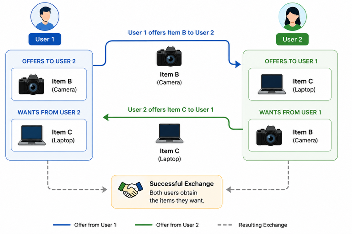
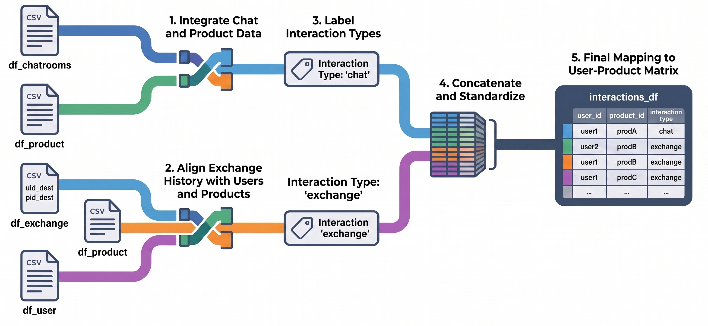
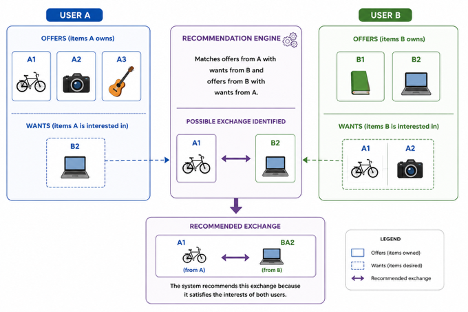
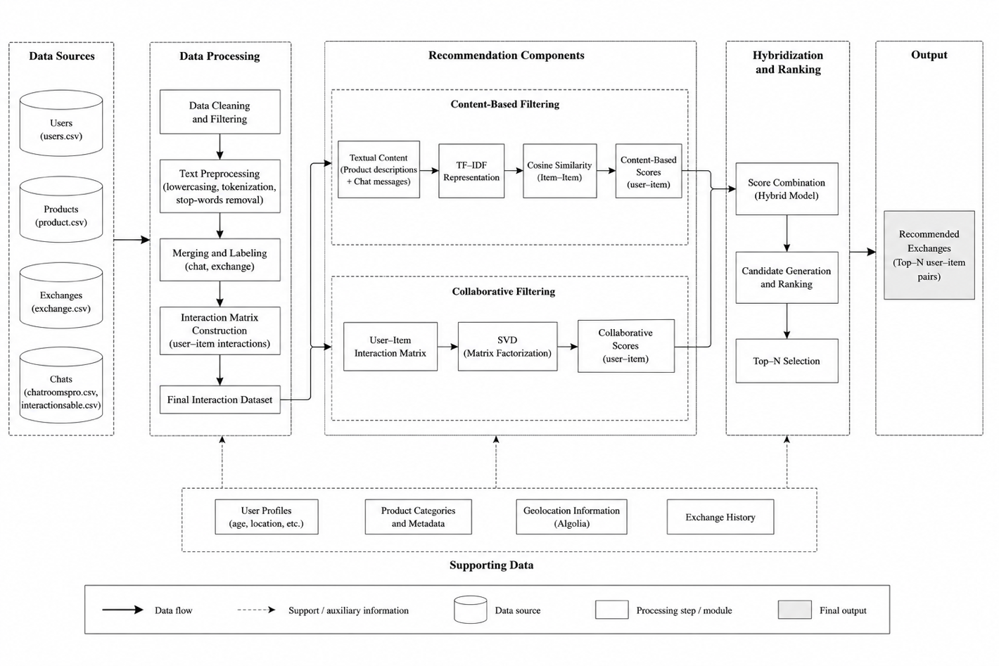

> **Repository note — not part of the original article.** This document is a Markdown transcription of the manuscript accepted in 2026 for publication in [*Journal of Advances in Information Technology (JAIT)*](https://www.jait.us/). A [PDF generated from this README](JAIT-Preprint.pdf?raw=true) is available for download.
>
> **Accepted-manuscript citation:** Azahara Martínez-Manzanares, Antonio Jesús Fernández-García, and Antonio Becerra-Terón, “Implementation of a Hybrid Recommender System for Peer-to-peer Exchange Optimization in Bartering Software Platforms,” *Journal of Advances in Information Technology*, 2026, accepted for publication.

---

# Implementation of a Hybrid Recommender System for Peer-to-peer Exchange Optimization in Bartering Software Platforms

Azahara Martínez-Manzanares <sup>1</sup>, Antonio Jesús Fernández-García <sup>2</sup>, and Antonio Becerra-Terón <sup>3*</sup>

1 Department of Informatics, University of Almería, Almería, Spain

2 Department of Informatics, Applied Computing Group (TIC-211), University of Almería, Almería, Spain

3 Department of Informatics, Information Systems Group (TIC-194), University of Almería, Almería, Spain

Email: amm579@ual.es (A.M.M.); ajfernandez@ual.es (A.J.F.G.); abecerra@ual.es (A.B.T.)

\*Corresponding author

## Abstract

Artificial Intelligence has significantly transformed user interactions in digital environments, particularly through recommender systems. While conventional recommender systems are primarily designed for unilateral transactional scenarios commonly found in e-commerce platforms, barter-based environments present a fundamentally different challenge: facilitating successful reciprocal exchanges between users through bidirectional matching. This paper addresses this challenge by designing and evaluating a hybrid recommender system for Swappito, a real-world digital bartering platform. The proposed approach combines Collaborative Filtering based on Singular Value Decomposition (SVD) to capture latent user–item interaction patterns with Content-Based Filtering techniques based on Term Frequency–Inverse Document Frequency (TF-IDF) and Cosine Similarity to exploit information extracted from product descriptions and user conversations. By integrating both recommendation paradigms, the system aims to improve the identification of mutually beneficial exchange opportunities. The system is evaluated using real-world platform data and a domain-specific metric, the Effective Exchange Success Rate ($`\%E_{\mathrm{eff}}`$), which measures the proportion of recommendations that result in completed exchanges involving the recommended products. Unlike traditional evaluation metrics that focus on relevance, ranking quality, clicks, or views, $`\%E_{\mathrm{eff}}`$ directly reflects the primary objective of barter platforms: enabling successful exchanges between users. Experimental results demonstrate the effectiveness of the hybrid approach, achieving a maximum $`\%E_{\mathrm{eff}}`$ of 36.25%. These findings indicate that the system can effectively support reciprocal product exchanges in non-monetary digital marketplaces and highlight the importance of domain-specific evaluation criteria for barter-oriented recommender systems.[^manuscript]

[^manuscript]: Manuscript received May 15, 2026; revised July 6, 2026; accepted August 4, 2026.

**Keywords—** recommender systems, barter platforms, hybrid recommender systems, reciprocal exchange, implicit feedback, exchange success rate

## I. Introduction

Recommender Systems (RS) have become a fundamental component of modern digital platforms, enabling personalized user experiences across domains such as e-commerce, streaming services, social networks, and online marketplaces [1](#ref-1), [2](#ref-2), [3](#ref-3), [4](#ref-4), [5](#ref-5). By analyzing user preferences and behavioral patterns, these systems help users discover relevant products, services, and content while improving user engagement and platform activity. The widespread adoption of recommendation technologies by platforms such as Netflix [6](#ref-6), [7](#ref-7) and Amazon [8](#ref-8), [9](#ref-9) illustrates their strategic importance in facilitating user-item interactions and supporting long-term user retention.

To support these functionalities, a wide range of techniques has been developed, including Collaborative Filtering (CF) [10](#ref-10), Content-Based Filtering (CBF) [11](#ref-11), Hybrid Recommender Systems [12](#ref-12), and, more recently, Deep Learning-based approaches [13](#ref-13), [14](#ref-14). Collaborative Filtering exploits patterns extracted from historical user interactions, operating under the assumption that users with similar preferences are likely to be interested in similar items. In contrast, Content-Based Filtering relies on item attributes and user profiles to recommend products that share characteristics with previously preferred items. Hybrid recommender systems combine both paradigms to mitigate their individual limitations, particularly data sparsity and cold-start problems [12](#ref-12). More recently, Deep Learning techniques, including neural architectures, Graph Neural Networks, and Transformer-based models, have advanced the state of the art by enabling the extraction of complex representations from large-scale interaction data and heterogeneous information sources [15](#ref-15), [16](#ref-16). As digital ecosystems become increasingly complex, developing recommendation technologies capable of exploiting heterogeneous sources of information and adapting to diverse user behaviors remains an active research challenge.

Despite the substantial advances achieved in recommendation technologies, most existing recommender systems have been designed for transactional environments, particularly e-commerce platforms [17](#ref-17). In these scenarios, recommendations are typically optimized to maximize the likelihood that a user will acquire a particular item. Consequently, the recommendation process is generally modeled as a unidirectional interaction between a user and a product, where the primary objective is to predict user preference, purchase intention, or engagement.

At the same time, exchange-based platforms [18](#ref-18), [19](#ref-19), [20](#ref-20), where users trade goods or services without monetary transactions, introduce a fundamentally different recommendation problem. In such environments, successful exchanges depend on the simultaneous satisfaction of two users, each offering and seeking different items. As a result, recommendations cannot be based solely on the preferences of a single user. Instead, the system must identify mutually beneficial exchange opportunities by solving a bidirectional matching problem in which both parties perceive value from the proposed exchange. This requirement shifts the optimization objective from predicting individual item relevance to estimating the likelihood of a successful reciprocal exchange.

Recommender systems have been extensively studied across a wide range of application domains. Nevertheless, comparatively little attention has been devoted to recommendation scenarios in which successful outcomes depend on reciprocal user satisfaction and exchange completion rather than individual item relevance. This gap is particularly evident in peer-to-peer bartering platforms, where the recommendation process must simultaneously consider the preferences, offers, and demands of multiple users to facilitate successful exchanges.

This work addresses this challenge using Swappito as a real-world case study, a peer-to-peer bartering platform designed to promote the exchange of second-hand products and user skills within a collaborative and sustainable ecosystem. Unlike conventional recommender systems that focus on recommending isolated items to individual users, Swappito requires recommendations that facilitate exchanges between pairs of users. To support this objective, we propose a hybrid recommender system that combines Collaborative Filtering and Content-Based Filtering techniques to identify user–product pairs with a high potential for successful exchange. [Fig. 1](#figure-1) illustrates the reciprocal exchange scenario considered in this work.

<a id="figure-1"></a>



Fig. 1. Example of a reciprocal exchange in a barter platform.

To address this research gap, we design, implement, and evaluate the proposed hybrid recommender system using real-world interaction data collected from the Swappito platform. The approach combines Collaborative Filtering and Content-Based Filtering techniques to identify exchange opportunities between users and estimate their likelihood of resulting in successful transactions. Its effectiveness is evaluated using real-world platform data and a domain-specific evaluation metric that captures the successful completion of exchanges. Furthermore, we discuss insights derived from previous studies conducted in similar contexts [21](#ref-21), [22](#ref-22). Accordingly, this study addresses the following research question: How can a hybrid recommender system combining Collaborative Filtering and Content-Based Filtering techniques be designed and implemented to maximize the probability of successful exchanges in peer-to-peer barter platforms such as Swappito?

The main contributions of this work are:

- Adaptation of Recommendation Algorithms to the Bidirectional Matching Problem: While techniques such as Singular Value Decomposition (SVD) for Collaborative Filtering and TF-IDF for Content-Based Filtering are well established, the primary contribution of this work lies in adapting these algorithms to address the bidirectional matching problem inherent to non-monetary bartering platforms. Rather than following the unilateral acquisition model typical of e-commerce, the system recommends user–item pairs with a high likelihood of resulting in successful reciprocal exchanges.

- Creation of a Stringent Custom Metric ($`\%E_{\mathrm{eff}}`$): Conventional evaluation metrics typically measure user interest through relevance, views, or clicks (e.g., Precision@K and Recall@K). To evaluate the Double Coincidence of Wants, this work introduces the Effective Exchange Success Rate ($`\%E_{\mathrm{eff}}`$), a domain-specific metric that measures the likelihood of completed reciprocal exchanges involving the exact item IDs recommended by the system.

- Real-World Deployment and Scalability: The proposed recommender system was deployed and empirically evaluated on the Swappito platform, demonstrating that the hybrid architecture operates efficiently in a real-world environment with more than 37,000 users while maintaining scalability and practical applicability.

The remainder of this paper is organized as follows. Section II reviews the related work on recommender systems, with particular emphasis on hybrid recommendation approaches and exchange-based environments. Section III presents the proposed methodology, including the Swappito platform and dataset, the challenges of barter recommendation, the Content-Based and Collaborative Filtering components, the hybrid recommendation strategy, and the evaluation protocol. Section IV presents and discusses the experimental results, including the comparison between TF-IDF and Transformer-based semantic representations. Finally, Section V summarizes the main conclusions of the study and outlines directions for future research.

## II. Literature Review

### A. Background

The rapid growth of digital data has driven the widespread adoption of Recommender Systems across a broad range of application domains. Recommendation technologies are now extensively used in e-commerce [23](#ref-23), social media [24](#ref-24), streaming services [25](#ref-25), education [26](#ref-26), [27](#ref-27), [28](#ref-28), and scientific publishing [29](#ref-29), where they support users in discovering relevant items within increasingly large and heterogeneous information spaces.

Traditionally, recommender systems have been built upon two fundamental paradigms: Content-Based Filtering (CBF) and Collaborative Filtering (CF) [2](#ref-2). Content-Based Filtering recommends items by exploiting similarities between item characteristics and user preferences [30](#ref-30), whereas Collaborative Filtering relies on historical user interactions to identify patterns of shared interest among similar users [31](#ref-31). Both approaches have demonstrated their effectiveness across multiple domains; however, they exhibit well-known limitations. Content-Based Filtering tends to recommend items closely related to a user's previous interests, potentially reducing recommendation diversity, whereas Collaborative Filtering is particularly affected by data sparsity and cold-start problems, especially for new users and newly introduced items.

To overcome these limitations, Hybrid Recommender Systems have emerged as one of the most widely adopted recommendation paradigms [32](#ref-32). By combining multiple recommendation techniques, hybrid approaches seek to exploit the strengths of individual models while mitigating their weaknesses. Several integration strategies have been proposed in the literature, including weighted, switching, mixed, cascade, and ensemble approaches [33](#ref-33). These hybridization mechanisms have consistently demonstrated improved recommendation performance, robustness, and adaptability across diverse application scenarios, making them particularly attractive for complex recommendation environments.

### B. Related Works

The development of recommender systems has been extensively studied across a wide range of application domains. However, most existing approaches have been designed for unidirectional transactional environments, such as e-commerce and media consumption platforms. To properly position the proposed Swappito recommender system, this section reviews the main recommendation paradigms and subsequently examines recommendation approaches developed for exchange and barter environments, highlighting the specific challenges that motivate the present work.

The design of recommendation systems for barter platforms is fundamentally different from that of conventional transactional systems. As discussed in the Introduction, traditional e-commerce platforms typically operate through unidirectional transactions, in which a buyer acquires goods or services from a seller [34](#ref-34). In contrast, successful barter transactions require reciprocal agreement and mutual value perception by both participants. Consequently, recommendation strategies for barter platforms must go beyond predicting individual user preferences and instead identify mutually beneficial exchange opportunities. This critical distinction became evident during preliminary experiments with proximity-based recommendation strategies, which were inspired by existing context-aware approaches as outlined in Ref. [22](#ref-22). While these preliminary systems successfully identified geographically relevant items, they were ultimately inadequate in capturing the reciprocal dynamics inherent to bartering, where a successful exchange relies on both users perceiving the transaction as equitable and mutually beneficial.

Several exchange-oriented platforms, such as BookMooch (https://es.bookmooch.com) and GameSwap (https://www.gameswap.org), have explored mechanisms for matching users with desired items. However, these platforms frequently rely on points-based exchange schemes that simplify the transaction process and do not fully capture the complexity of peer-to-peer barter environments, where successful exchanges depend on reciprocal user satisfaction.

Within the broader recommender systems literature, Collaborative Filtering (CF) remains one of the most widely adopted recommendation paradigms. Both memory-based approaches (e.g., user-based and item-based methods) and model-based approaches (e.g., matrix factorization and clustering techniques) have demonstrated strong predictive performance in traditional recommendation scenarios [10](#ref-10), [12](#ref-12). Nevertheless, these methods are primarily designed to predict individual user preferences and do not explicitly model the reciprocal agreement required to complete a barter transaction.

Content-Based Filtering (CBF) represents an alternative recommendation paradigm based on the characteristics of items and user preferences [11](#ref-11). These approaches frequently employ techniques derived from natural language processing and machine learning to represent and compare item descriptions. In contrast, barter platforms often contain highly heterogeneous and unstructured product descriptions, including informal expressions such as “vintage bicycle (needs re-fit)” or “wooden table (minor scratch)”. Such variability can reduce the effectiveness of traditional similarity measures and highlights the importance of advanced semantic representation techniques. In this context, Transformer-based models such as BERT offer promising capabilities for capturing semantic relationships within unstructured textual content.

In the specific context of barter platforms, Rappaz et al. [20](#ref-20) proposed a matrix factorization approach tailored to exchange environments. Although the reported results demonstrated encouraging predictive performance, the evaluation primarily focused on interaction prediction rather than successful exchange completion. Similarly, context-aware recommendation approaches such as those discussed by Kulkarni and Rodd [22](#ref-22) incorporate contextual information, including temporal and geographical factors, to improve recommendation quality. However, these approaches continue to formulate recommendations as unilateral suggestions rather than reciprocal agreements between users.

Recent advances in Deep Learning have significantly expanded the capabilities of recommender systems. Autoencoders, generative models, and representation learning techniques have demonstrated promising results for addressing dimensionality reduction and cold-start problems [13](#ref-13). Reinforcement Learning approaches, such as those proposed by Chen et al. [20](#ref-20), dynamically adapt recommendations according to user behavior and interaction feedback, improving recommendation effectiveness over time. Nevertheless, these methods are typically optimized using engagement-oriented objectives, such as clicks, views, or ratings. In barter environments, the recommendation objective differs substantially, as successful outcomes depend on completed exchanges and reciprocal user satisfaction.

Graph-based recommendation has recently emerged as a promising research direction. Lu et al. [24](#ref-24) demonstrated that Graph Neural Networks (GNNs) can effectively model higher-order relationships in social commerce environments, exploiting structural information among users, items, and interactions. This paradigm is particularly attractive for barter ecosystems because exchanges naturally form interconnected networks involving users, products, conversations, and historical transactions. By explicitly modeling these relationships, GNN-based approaches offer the potential to capture reciprocity, trust, and exchange dynamics within collaborative marketplaces.

Finally, the evaluation of recommender systems for barter environments presents additional challenges. Traditional offline metrics, such as precision and recall, primarily assess recommendation relevance and ranking quality but do not directly measure successful exchange completion. Consequently, evaluation methodologies for barter platforms should consider the reciprocal nature of exchanges and the extent to which recommendations facilitate mutually beneficial transactions. This limitation motivates the development of domain-specific evaluation criteria capable of assessing recommendation effectiveness from the perspective of successful exchange realization.

## III. Methodology

This section presents the methodological framework of the proposed hybrid recommender system for reciprocal bartering platforms. The framework addresses the distinctive challenges of recommendation in non-monetary exchange environments by integrating semantic information extracted from product descriptions with behavioral information derived from user interactions. The proposed methodology comprises the design of the recommendation framework and the evaluation protocol adopted to assess its effectiveness under realistic platform conditions.

### A. Platform and Dataset

Swappito is a peer-to-peer digital bartering platform that enables users to exchange products, skills, and donations without monetary transactions. The platform provides a real-world environment for evaluating the hybrid recommender system. The dataset, extracted from a January 2025 snapshot, comprises over 37,000 users, approximately 4000 active items, and more than 20,000 user conversations across 15 countries. It includes user profiles, product descriptions, chat conversations, and exchange records, providing the heterogeneous information required by the recommendation process.

The recommender system relies on a comprehensive dataset collected from user activity on the Swappito platform, focusing on data related to users, items, and their interactions.

- User Profiles: User attributes and optional geolocation information used to support location-aware recommendations.

- Items Description: Product descriptions and category labels provided by users. Descriptions are typically unstructured and heterogeneous, often containing informal language and varying levels of detail.

- Interaction Data: The data are obtained from two primary sources, interaction chats (the messages occurring during exchanges, predominantly in Spanish) and exchange history (records of completed exchanges).

The raw dataset, extracted directly from the platform databases in the following files: chatroomspro.csv, exchange.csv, interactionstable.csv, product.csv, and users.csv. It consists of user registries, product catalogs, exchange logs, and chatrooms. Records lacking critical identifiers (e.g., missing user_id or product_id) or featuring empty text descriptions were filtered out. To prepare the textual data for the TF-IDF algorithm, product descriptions and chat messages were preprocessed, text was converted to lowercase, special characters and punctuation were removed, and stop-words were filtered out to ensure a high-quality, noise-free vocabulary. To construct the final interaction dataset, we implemented a structured merging pipeline using the raw database exports that is described in [Fig. 2](#figure-2).

<a id="figure-2"></a>



Fig. 2. Data processing.

First, chat logs (df_chatrooms) are merged with the catalog (df_product) and labeled as “chat” interactions. Concurrently, completed trade records (df_exchange) are merged with both product and user databases (df_user) and labeled as 'exchange' interactions. Finally, both data streams are concatenated and standardized to generate the unified interactions_df matrix, which accurately maps each specific user_id to a product_id along with its respective interaction weight.

### B. Challenges in Barter Recommendation

The design of the recommender system is influenced by several characteristics of the platform that directly affect both recommendation generation and evaluation. Unlike conventional recommendation environments, recommendations are expected to facilitate successful exchanges between users while operating on heterogeneous and sparse interaction data. These characteristics introduce several challenges that must be addressed to produce effective recommendations.

- User-Item Pair Recommendations. Swappito operates at the exchange level. Consequently, the recommendation process must evaluate potential user–item pairs by jointly considering the offers and demands of multiple users. [Fig. 3](#figure-3) illustrates a representative barter scenario in which the system analyzes the compatibility between users and their associated items to identify potential exchange opportunities.

- All items are unique. Items are typically unique because their condition and perceived value vary across users. As a result, recommendations must target specific item instances, making successful exchange prediction substantially more demanding.

- Sparsity and Cold-Start Problem. Although Swappito comprises a large user community, the number of observed interactions remains relatively limited compared with the space of potential exchanges. This sparsity, combined with the continuous arrival of new users and items, restricts the amount of historical information available for learning and constitutes a major challenge for personalized recommendation.

<a id="figure-3"></a>



Fig. 3. Visual representation of users’ offers and wants for a bartering exchange (User-item Pairs).

To address these challenges, the recommender system is organized as a hybrid recommendation pipeline that combines content-based recommendation and collaborative strategies. Content-based methods leverage semantic information extracted from product descriptions and user-generated content to refine these recommendations [11](#ref-11), [35](#ref-35), whereas collaborative techniques exploit historical interaction patterns among users to identify potential exchange candidates [36](#ref-36). Rather than operating independently, these complementary strategies are integrated into a unified hybrid recommendation framework. As illustrated in [Fig. 4](#figure-4), the recommendation process comprises three main stages. First, heterogeneous platform data are integrated and transformed into a unified interaction dataset. Second, the collaborative component generates an initial set of recommendation candidates from historical user interactions, while the content-based component exploits semantic similarities between product descriptions and exchange-related conversations to refine these candidates. Finally, both sources of information are combined within the hybrid recommendation model to produce the final ranked list of exchange recommendations.

<a id="figure-4"></a>



Fig. 4. Overview of the proposed recommendation framework.

### C. Content-based Filtering Component

This component exploits the textual information available within the Swappito platform to identify products that are semantically related to users’ interests. Specifically, two complementary sources of information are considered: (i) product descriptions provided by users and (ii) chat conversations generated during exchange negotiations. By leveraging these textual resources, the system constructs item representations and estimates content similarity, enabling the generation of personalized recommendations based on product characteristics and historical user interactions.

To transform unstructured textual information into a numerical representation suitable for recommendation, the proposed approach employs the Term Frequency–Inverse Document Frequency (TF-IDF) weighting scheme. This representation captures the relative importance of terms within product descriptions and interaction conversations, providing a robust basis for subsequent similarity analysis.

TF-IDF computes the importance of a word in a document by evaluating two factors:

- Term Frequency (TF): The frequency of a term in a document (in our case, and as previously mentioned, a product description or an interaction chat for an individual exchange).

- Inverse Document Frequency (IDF): The rarity of a word in all documents (all product descriptions or all interaction chats for all exchanges).

The TF-IDF weight of a term $`t`$ in a document $`d`$ within a collection of documents $`D`$ is defined as:

 <a id="eq-1"></a>

```math
\text{TF-IDF}(t,d,D)=\mathrm{TF}(t,d)\times\mathrm{IDF}(t,D)\qquad\text{(1)}
```

Term Frequency measures how frequently a term occurs in a document. It is calculated as:

 <a id="eq-2"></a>

```math
\mathrm{TF}(t,d)=\frac{f_{t,d}}{\sum_{t^{\prime}\in d}f_{t^{\prime},d}}\qquad\text{(2)}
```

where:

$`f_{t,d}`$ : number of times term $`t`$ appears in document $`d`$.

$`\sum_{t^{\prime}\in d}f_{t^{\prime},d}`$ : total number of terms in document $`d`$.

Inverse Document Frequency measures how relevant a term is across the entire corpus:

 <a id="eq-3"></a>

```math
\mathrm{IDF}(t,D)=\log\left(\frac{N}{\lvert\{d\in D:t\in d\}\rvert}\right)\qquad\text{(3)}
```

where:

$`N`$: total number of documents in the corpus $`D`$.

$`\lvert\{d\in D:t\in d\}\rvert`$: number of documents where term $`t`$ appears.

In the framework, each document $`d`$ represents either a product description or a chat conversation, while $`D`$ denotes the complete textual corpus. The TF-IDF weighting scheme emphasizes informative terms and generates vector representations that capture the semantic content of products and user interactions. These representations are subsequently compared using Cosine Similarity to quantify the degree of similarity between products.

 <a id="eq-4"></a>

```math
\mathit{Cosine\ Similarity}=\frac{A\times B}{\lvert A\rvert\lvert B\rvert}\qquad\text{(4)}
```

where:

$`A`$ and $`B`$ are vectors representing two products.

$`A\times B`$ denotes the product between vectors $`A`$ and $`B`$.

$`\lvert A\rvert\lvert B\rvert`$ denote the norms of vectors $`A`$ and $`B`$, respectively.

Cosine Similarity is subsequently applied to the TF-IDF representations to quantify the semantic similarity between products. The resulting similarity scores are used to identify and rank candidate recommendations, where higher values indicate stronger semantic correspondence.

### D. Collaborative Filtering Component

The collaborative component exploits historical user interactions recorded within the Swappito platform to uncover latent behavioral patterns and infer user preferences. Unlike the content-based module, which relies on textual information, collaborative filtering leverages collective interaction histories to identify associations between users and products without requiring explicit content descriptors.

To model these interactions, the proposed approach employs Singular Value Decomposition (SVD), a dimensionality reduction technique that captures the most relevant patterns in a user product interaction matrix. This approach allows the system to generate personalized recommendations by leveraging behavioral similarities, even in contexts where content-based information is sparse or unavailable.

SVD is a specific matrix factorization method used to decompose large sparse matrices (like user-product interaction matrices) into smaller and dense matrices that capture latent features such as user preferences and product characteristics. Concretely, SVD decomposes a matrix $`A`$ into three matrices:

 <a id="eq-5"></a>

```math
A=U\times\Sigma\times V^{T}\qquad\text{(5)}
```

where:

$`U`$ represents the user feature matrix,

$`\Sigma`$ contains singular values (latent factors),

$`V^{T}`$ is the product feature matrix.

This decomposition reveals latent relationships between users and products, enabling the estimation of unobserved interactions within the user–item matrix. Consequently, the model can infer potential user preferences and generate personalized recommendations, even in the absence of explicit historical interactions.

The development of the collaborative filtering–based recommender involves several key steps, as outlined below.

- Data Collection and Integration. The collaborative recommendation process starts by consolidating information from the multiple sources within the Swappito platform, including user profiles, product listings, exchange records, and chat conversations. Most chat interactions are conducted in Spanish.

- User-Product Interaction Matrix. User interactions are represented through a user–item interaction matrix, where each entry encodes the implicit preference of a user for a given product based on historical interactions, such as chat conversations and completed exchanges.

- Interaction Weighting. Interaction events are weighted according to their relative importance to capture the strength of user preferences. In particular, recurrent chat interactions and completed exchanges are assigned higher weights, as they provide stronger evidence of user interest.

- Matrix Factorization. SVD is applied to the user–item interaction matrix to extract latent factors that characterize underlying user preferences and product associations.

The collaborative filtering process adopted in this work encompasses the construction of the weighted user–item interaction matrix, the extraction of latent factors through SVD, and the subsequent generation of personalized recommendations.

### E. Hybrid Recommendation Strategy

Given the complementary nature of content-based and collaborative filtering techniques, both components are integrated into a unified hybrid recommendation model. This integration aims to overcome the limitations of individual approaches, particularly data sparsity and cold-start problems, which constitute major challenges in peer-to-peer barter environments.

The proposed hybrid recommender system combines collaborative and content-based filtering in a sequential manner. First, the collaborative component, based on SVD, generates an initial set of candidate recommendations from historical user interactions. Subsequently, the content-based component refines these candidates by identifying products that are semantically related through TF-IDF representations and Cosine Similarity measures. By jointly exploiting behavioural patterns and product characteristics, this two-step strategy enhances the relevance of the final recommendations.

The contribution of each recommendation component is controlled through a weighted linear combination, which provides a flexible balance between collaborative signals and content information. This mechanism is particularly valuable in sparse environments, where interaction data alone may be insufficient to produce reliable recommendations.

To assess the impact of each component, several hybrid configurations were evaluated by varying the relative weights assigned to the collaborative and content-based modules, as described below:

- Hybrid 100/0, Pure Collaborative Filtering

- Hybrid 80/20, Predominantly Collaborative Filtering

- Hybrid 70/30, Moderately Collaborative Filtering

- Hybrid 50/50, Equal Contributions - Collaborative and Content

- Hybrid 30/70, Predominantly Content-Based

A purely content-based configuration (i.e., Hybrid 0/100) is not considered in this study because the architecture inherently relies on the user–item interaction matrix as its primary input. Consequently, the collaborative filtering component based on SVD constitutes the initial stage of the recommendation process.

The hybrid strategy aims to exploit the complementary strengths of collaborative and content-based filtering to generate more accurate and robust exchange recommendations within the specific context of a peer-to-peer barter platform.

### F. Evaluation Protocol

This subsection presents the evaluation protocol adopted to assess the hybrid recommender system. Given the distinctive characteristics of reciprocal bartering platforms, conventional recommendation metrics are first analyzed to motivate the need for a domain-specific evaluation measure. Accordingly, traditional recommendation metrics, such as Precision@K and Recall@K, are inherently designed to evaluate unilateral transactional paradigms [37](#ref-37). In standard e-commerce, these metrics successfully measure one-sided user intent by counting clicks, views, or unilateral purchases as a “hit”.

Nevertheless, these metrics are fundamentally insufficient for bartering platforms because they fail to account for the “Double Coincidence of Wants”, i.e., the strict requirement that both parties must find mutual value and agree to a reciprocal trade. A recommendation might be highly relevant (achieving high Precision), but if the receiving user has nothing of interest to offer in return, the exchange fails.

To overcome this limitation, we propose the Effective Exchange Success Rate ($`\%E_{\mathrm{eff}}`$). Unlike traditional metrics that overestimate success by measuring mere interest, $`\%E_{\mathrm{eff}}`$ provides a significantly more stringent and practical evaluation. A recommendation is considered successful only when a bidirectional, mutually agreed transaction is fully completed, specifically involving the exact unique item-IDs recommended by the system. This distinction ensures that the system's performance is measured by actual market liquidity and successful trades, rather than isolated user clicks.

In contrast, the evaluation of recommender systems in barter platforms is particularly challenging due to several domain-specific characteristics:

- Low level of engagement. Online bartering platforms struggle significantly with engagement, despite utilizing modern technology, primarily because of fundamental challenges inherent in a non-monetary system. The most foundational issue is the Double Coincidence of Wants, which dictates that a “perfect match” is required for any exchange, severely limiting transaction potential. This problem is compounded by the difficulty of discovering which specific items users possess and the deeply subjective valuation of those items (people tend to overvalue their own goods and undervalue what they are receiving). Finally, the non-professional nature of the participants introduces high negotiation complexity and often results in insufficient mutual trust, adding significant friction to the exchange process.

- Lack of Standardization and Product Heterogeneity. When dealing with standardized goods, there is an established expectation of quality. In contrast, almost every physical item involved in bartering is a unique instance. Even if the products are identical, their condition (or state of preservation) creates significant variability. Furthermore, bartering users are typically not specialized as they often offer a wide and heterogeneous variety of items.

Consequently, the evaluation protocol is centered on the Effective Exchange Success Rate ($`\%E_{\mathrm{eff}}`$) a metric specifically designed to quantify successful reciprocal exchanges. Unlike conventional recommendation metrics, $`\%E_{\mathrm{eff}}`$ measures only completed bidirectional transactions involving the recommended items. Its formal definition is given below.

Let $`U_{\mathrm{rec}}`$ be the set of users who received recommendations during the evaluation period:

```math
U_{\mathrm{rec}}=\{u_1,u_2,\ldots,u_n\}
```

where $`u_i\in U_{\mathrm{rec}}`$ represents a user who has received the recommended items from the system and $`\lvert U_{\mathrm{rec}}\rvert`$ is the total number of users exposed to the recommendations of the system.

Let $`U_{\mathrm{act}}`$ denote the subset of users who have completed at least one exchange (e.g., chat initiation or product exchange) after the data split date:

```math
U_{\mathrm{act}}=\{u_1,u_2,\ldots,u_m\},\ \text{where }m\leq n
```

This subset includes users who have interacted with the system in an effective way.

To assess the effectiveness of the recommendations and user interactions, a per-user hit function, denoted as $`\mathrm{hit}(u)`$, is introduced and defined as follows:

 <a id="eq-6"></a>

```math
\mathrm{hit}(u)=\begin{cases}1,&\text{if }R(u)\cap I(u)\neq\varnothing\\0,&\text{if }R(u)\cap I(u)=\varnothing\end{cases}\qquad\text{(6)}
```

where:

- $`R(u)`$ represents the set of items recommended to user $`u`$,

- $`I(u)`$ represents the set of items that user $`u`$ has exchanged,

- $`\mathrm{hit}(u)=1`$ indicates that at least one recommended item was exchanged by the user, and

- $`\mathrm{hit}(u)=0`$ indicates that none of the recommended items were exchanged by the user.

Now, Estimated Exchange Initiations is defined based on the set $`E_{\mathrm{est}}\subset U_{\mathrm{rec}}`$ which comprises users who initiated a chat or exchange after receiving recommendations based on system suggestions.

```math
E_{\mathrm{est}}=\{u_1,u_2,\ldots,u_k\},\ \text{where }k\leq n
```

This set tracks users who engaged with the system by taking actions based on the recommendations they received. Accordingly, the following metric is defined as:

Estimated Exchange Success Rate ($`\%E_{\mathrm{est}}`$), calculated as the ratio of users who initiated interactions to the total numbers of users who received recommendations.

 <a id="eq-7"></a>

```math
\%E_{\mathrm{est}}=\frac{1}{\lvert U_{\mathrm{rec}}\rvert}\sum_{u\in U_{\mathrm{rec}}}\mathrm{hit}(u)\qquad\text{(7)}
```

In the same sense, Effective Exchange Initiations is defined as follows. Let $`E_{\mathrm{eff}}\subset U_{\mathrm{act}}`$ be the subset of users who actually completed an exchange (i.e., users who not only initiated an exchange but also finalized it; that is an effective exchange):

```math
E_{\mathrm{eff}}=\{u_1,u_2,\ldots,u_l\},\ \text{where }l\leq m
```

Effective Exchange Success Rate ($`\%E_{\mathrm{eff}}`$), computed as the ratio of users who actually completed an exchange out of the total number of active users, calculated as:

 <a id="eq-8"></a>

```math
\%E_{\mathrm{eff}}=\frac{1}{\lvert U_{\mathrm{act}}\rvert}\sum_{u\in U_{\mathrm{act}}}\mathrm{hit}(u)\qquad\text{(8)}
```

This metric provides a direct measure of the effectiveness of the recommendation system in driving actual exchanges, capturing users who not only interacted with the system, but also successfully followed through on the exchange.

Beyond the definition of the evaluation metric, a realistic evaluation protocol is also required to ensure that the reported performance accurately reflects the operational conditions of the platform. Accordingly, the proposed hybrid recommender system is evaluated using a chronologically separated and temporally consistent protocol. The evaluation is structured to closely mimic real-world deployment, ensuring that future recommendations are generated exclusively from past information. This protocol simulates realistic operating conditions while addressing challenges such as data sparsity and item variability.

Dividing the historical user interaction data into two distinct sets. The training dataset (past) contains all user activity and interactions that occurred up to a specific cut-off date (the “Split Date”). The recommender system model uses only this past data to learn user preferences and latent factors. The testing dataset (future) contains all user activity and exchanges that occurred after the cut-off date. It is important to note that the data landscape changes over time, in the future, new items unknown to the model may be added while others are deleted. The same dynamics apply to users. Furthermore, user profiles or item descriptions could also be modified.

The chronological (not random) separation ensures that the model never uses knowledge of a future event (like a completed exchange) to predict that same event. Then, it prevents data leakage, which occurs when information from the test set (the future) accidentally influences the training of the model (the past).

## IV. Results and Discussion

This section presents the experimental results obtained according to the evaluation protocol and performance metrics defined in the evaluation protocol.

### A. Overall Recommendation Performance

The hybrid recommender system is evaluated using five hybrid configurations, ranging from Pure Collaborative Filtering to Predominantly Content-based recommendation, under different recommendation list sizes and the chronological train-test partitions. The main experimental settings are summarized below.

- Configuration: This column specifies the setup or variant of the hybrid recommender system that was evaluated, including adjustments to model parameters or algorithmic variations.

- $`N_{\mathrm{rec}}`$: The total number of recommendations made by the system for the given configuration. This value indicates the volume of items suggested to users during the experiment.

- Time Split: This column refers to the ratio of training-to-testing data used in the experiment. For example, a time split of 80/20 means 80% of the data was used for training, and the remaining 20% was used to test the model.

- Split Date: The specific date used to divide the historical data into training and testing sets. This allows us to simulate real-world conditions where recommendations are made based on past user interactions.

- $`U_{\mathrm{rec}}`$: The set of users who received recommendations in the system. This set is derived from the total number of users exposed to the recommendation process during the experiment.

- $`U_{\mathrm{act}}`$: The set of users who were active enough to complete at least one exchange or interaction on the platform after receiving recommendations. These users are considered more engaged and provide a more meaningful evaluation of the effectiveness of the recommendation system.

- $`N_{\mathrm{hit}}`$: The number of “hits” or successful recommendations in which the user interacts with a recommended item based on the hit function described previously. A hit is defined as a case where the recommended item matches the user’s final selection.

- $`\%E_{\mathrm{est}}`$: The estimated proportion of users who initiated an interaction (such as a chat or exchange) as a result of receiving a recommendation. This value provides an approximation of the system’s impact on user engagement.

- $`\%E_{\mathrm{eff}}`$: The proportion of users in the set $`U_{\mathrm{act}}`$ who initiated a chat or exchange an item based on the recommendations they received (i.e. an effective exchange). This metric offers a more refined view of the system effectiveness, focusing on users who are already active on the platform, and thus more likely to respond to recommendations.

This temporal evaluation framework does not rely on a random data sample but rather processes the complete dataset of active users (the whole population) on the Swappito platform during the evaluated periods (and for this reason traditional statistical significance testing is not applied). Therefore, the defined metric successfully represents completed reciprocal transactions across the entire platform (not stochastic estimates).

The hybrid recommender system was evaluated through a comprehensive experimental evaluation, encompassing multiple recommendation settings. Specifically, five hybrid configurations (Hybrid 100/0, 80/20, 70/30, 50/50, and 30/70) were evaluated across four chronological train-test partitions (50/50, 60/40, 70/30, and 80/20) and three recommendation list sizes ($`N_{\mathrm{rec}}`$ = 5, 10, and 20), resulting in a total of 60 experimental configurations. [Table I](#table-i) reports the representative hybrid recommendation configurations that achieved the best overall performance. All configurations with $`N_{\mathrm{rec}}`$ = 20 and a 60/40 chronological train-test partition achieved the highest $`\%E_{\mathrm{eff}}`$ (36.25%), regardless of the hybrid weighting ratio. The complete set of evaluated configurations is provided in [Table AI](#table-ai) in the Appendix.

<a id="table-i"></a>

TABLE I. BEST-PERFORMING HYBRID RECOMMENDATION CONFIGURATIONS

| Configuration | $`N_{\mathrm{rec}}`$ | Time Split | Split Date | $`U_{\mathrm{rec}}`$ | $`U_{\mathrm{act}}`$ | $`N_{\mathrm{hit}}`$ | $`\%E_{\mathrm{est}}`$ | $`\%E_{\mathrm{eff}}`$ |
| --- | --- | --- | --- | --- | --- | --- | --- | --- |
| Hybrid 80/20 | 20 | 60%/40% | 22/09/2024 | 515 | 80 | 29 | 5.63 | 36.25 |
| Hybrid 70/30 | 20 | 60%/40% | 22/09/2024 | 515 | 80 | 29 | 5.63 | 36.25 |
| Hybrid 50/50 | 20 | 60%/40% | 22/09/2024 | 515 | 80 | 29 | 5.63 | 36.25 |
| Hybrid 30/70 | 20 | 60%/40% | 22/09/2024 | 515 | 80 | 29 | 5.63 | 36.25 |

### B. Comparison with Transformer-based Model

To rigorously evaluate our methodological choices and assess the potential of deep learning architectures, we replaced the TF-IDF module with the pre-trained Transformer model bert-base-multilingual-cased, which generates dense semantic embeddings from heterogeneous product descriptions and predominantly Spanish chat interactions. Following the same hybrid integration strategy, the Bidirectional Encoder Representations from Transformers (BERT)-based recommender was evaluated under the previously identified optimal experimental conditions ($`N_{\mathrm{rec}}`$ = 20, 60/40 chronological train-test partition) using the same evaluation protocol and performance metrics described in Section III.

[Table II](#table-ii) summarizes the corresponding experimental results obtained using BERT embeddings instead of TF-IDF for textual representation. The two highest-weighted hybrid configurations (80/20 and 70/30) produced identical values across all evaluation metrics, achieving $`N_{\mathrm{hit}}`$ = 28, $`\%E_{\mathrm{est}}`$ = 5.43, and a maximum $`\%E_{\mathrm{eff}}`$ = 35.00. Although these results indicate consistent performance of the hybrid strategy when using Transformer-based semantic representations, they remain below the best TF-IDF-based configuration, which achieved a $`\%E_{\mathrm{eff}}`$ of 36.25%. Moreover, increasing the contribution of the BERT component did not lead to further improvements in any of the reported evaluation metrics. These findings suggest that, despite the superior semantic capabilities of Transformer models, their direct application to sparse and highly informal bartering environments does not necessarily translate into higher recommendation effectiveness. This observation is further discussed in Section IV.

<a id="table-ii"></a>

TABLE II. BEST-PERFORMING HYBRID RECOMMENDATION CONFIGURATIONS USING BERT EMBEDDINGS

| Configuration | $`N_{\mathrm{rec}}`$ | Time Split | Split Date | $`U_{\mathrm{rec}}`$ | $`U_{\mathrm{act}}`$ | $`N_{\mathrm{hit}}`$ | $`\%E_{\mathrm{est}}`$ | $`\%E_{\mathrm{eff}}`$ |
| --- | --- | --- | --- | --- | --- | --- | --- | --- |
| Hybrid 80/20 | 20 | 60%/40% | 22/09/2024 | 515 | 80 | 28 | 5.43 | 35.00 |
| Hybrid 70/30 | 20 | 60%/40% | 22/09/2024 | 515 | 80 | 28 | 5.43 | 35.00 |
| Hybrid 50/50 | 20 | 60%/40% | 22/09/2024 | 515 | 80 | 24 | 4.66 | 30.00 |
| Hybrid 30/70 | 20 | 60%/40% | 22/09/2024 | 515 | 80 | 19 | 3.68 | 23.75 |

### C. Comparative Analysis with Existing Work

To contextualize our findings, we performed a comparative analysis with other recent studies in the field of recommendation systems, particularly those relevant to bartering or exchange-based platforms. Although most of the referenced systems were not specifically designed for bartering contexts, they still offer valuable insights into recommendation performance across various domains. For example, Suresh et al. [17](#ref-17) applied advanced deep learning techniques, including Gated Recurrent Units (GRUs) and Broyden–Fletcher–Goldfarb–Shanno (BFGS) optimization, in e-commerce environments, achieving impressive precision levels. However, their models relied heavily on dense interaction data, which is less common in the sparse data environments typically encountered in bartering systems.

<a id="table-iii"></a>

TABLE III. COMPARATIVE ANALYSIS OF RECOMMENDATION SYSTEMS FOR BARTERING PLATFORMS

| Study | Focus | Algorithms | Hybrid | Metrics |
| --- | --- | --- | --- | --- |
| Kulkarni & Rodd (2020) [22](#ref-22) | Context-aware | Context-CF | Yes | F1: 0.89 |
| Suresh et al. (2024) [17](#ref-17) | E-commerce | GRU+BFGS | Yes | Prec.: 0.92 |
| Chen et al. (2023) [16](#ref-16) | Dynamic | DQN, PPO | No | Ret.: 0.18% |
| Lu et al. (2025) [24](#ref-24) | Social | GNNs | Yes | AUC: 0.91 |
| Rappaz et al. (2017) [20](#ref-20) | Bartering | Matrix Fact. | No | Exch.: 0.63 |
| Our Work | Bartering | Matrix Fact. + Content-Based | Yes | Effec. Exch.: 0.3625 |

Notes: Prec. = Precision; Ret. = Retention; Exch. = Exchange Rate; Effec. Exch. = Effective Exchange Success Rate

Similarly, context-aware systems, such as those developed by Kulkarni and Rodd [22](#ref-22), employed collaborative contextual filtering to enhance personalization and improve recommendation accuracy. Other studies, such as those of Lu et al. [24](#ref-24), have explored the use of Graph Neural Networks (GNNs) to analyze social interactions and improve recommendation models in social settings. In contrast to systems that rely on dense data, our platform operates under considerably sparser user interaction patterns, facing challenges such as cold-start problems, item duplication, or dynamic seasonal exchange patterns. Despite these significant constraints, several of our hybrid models achieved an effective exchange success rate of 36.25%, which is a noteworthy result when compared to previous work on bartering systems.

Importantly, this metric does not simply reflect how interesting a recommendation is to users, but rather how likely it is to result in an actual and successful exchange, specifically between users offering and requesting the exact same item ID. In this context, even a moderate percentage is highly valuable as it ensures a reliable outcome, not just user interest or interaction. Therefore, our system not only demonstrates accuracy but also practical effectiveness, facilitating meaningful transactions in a real-world bartering environment.

Finally, [Table III](#table-iii) provides a comparison of the focus, algorithms, hybridization strategies, and evaluation metrics used in several existing recommender systems, including those applied in bartering and exchange-based contexts. By examining these aspects, we highlight the distinctions between our methodology and the approaches previously explored, emphasizing the contributions and performance of our hybrid model in comparison to the state of the art. A key advantage of our system lies in its ability to measure the actual likelihood of effective exchanges occurring based on user interactions within the platform. Although our model might report lower percentages than some prior work, our metric provides a more grounded and practical evaluation, reflecting the true potential for successful exchanges between users as a direct result of the recommendations generated by the system.

### D. Discussion

The experimental results reveal the strengths and limitations of the hybrid recommender system, examines the implications of the evaluated configurations, and assesses their impact on recommendation performance in peer-to-peer barter environments. Both quantitative and qualitative findings are considered.

#### 1) Custom metric

To evaluate this approach, the Effective Exchange Success Rate ($`\%E_{\mathrm{eff}}`$) is employed. Unlike traditional recommendation metrics, which are primarily designed for unilateral transactional scenarios such as clicks or purchases, $`\%E_{\mathrm{eff}}`$ measures the ability of the system to facilitate successful reciprocal barter transactions. Consequently, it provides a more realistic assessment of recommendation performance in peer-to-peer exchange environments. This evaluation criterion is considerably more demanding than conventional metrics, as it only registers success when a recommendation ultimately results in a completed barter transaction. Although the reported success rate of 36.25% may appear lower than the performance values typically reported for recommender systems operating on dense e-commerce datasets (e.g., F1-score = 0.89 or Precision = 0.92), it constitutes a substantially more stringent measure of effectiveness. Therefore, the obtained results demonstrate the practical effectiveness of the proposed recommender system in achieving the primary objective of barter platforms, namely, facilitating successful reciprocal exchanges rather than merely predicting user interest.

#### 2) User behavior and dynamics

The unique features of our platform, including sparse user interactions, cold-start users, item duplication, and seasonal fluctuations in activity, present distinct challenges. These factors restrict the volume of historical data available for model training, influencing the performance of various models in different ways. Specifically, models that rely heavily on the history of users or items may face difficulties due to the limited amount of interaction data, which could impact their ability to generate accurate and personalized recommendations.

#### 3) Limitations, scalability, and deployment challenges

Deploying the recommender system in the live Swappito ecosystem reveals the following practical boundaries.

- Regarding limitations, the system currently evaluates success strictly on exact unique item-ID matches. It lacks a “Product Equivalence” model to recognize when different users upload identical items, which artificially restricts potential matches.

- Concerning scalability, while TF-IDF and SVD are computationally efficient for our current base of over 37,000 users, scaling to millions of users will necessitate architectural evolutions. Particularly, the frequent recalculation of the SVD interaction matrix will become computationally expensive, likely requiring a shift toward asynchronous batch-processing to avoid bottlenecking the Node.js and Firebase infrastructure.

- Opting for TF-IDF over BERT is currently advantageous. As our results show, standard BERT underperforms in this context. To surpass TF-IDF in the future, we would need to implement BERT with fine-tuning, which introduces substantial computational overhead, specialized GPU infrastructure, and high operational costs. By sticking to TF-IDF, we maintain higher accuracy ($`\%E_{\mathrm{eff}}`$) with a lightweight and computationally efficient solution.

#### 4) Rationale for using TF-IDF

While acknowledging the existence of modern Deep Learning alternatives to text representation, such as Word2Vec and BERT, this work deliberately employs the TF-IDF approach due to its significant practical advantages, particularly for a platform like Swappito. The selection is driven by three critical factors:

- Efficiency and Performance: TF-IDF offers superior computational efficiency, being substantially faster and requiring far fewer resources than deep learning models. This is crucial for a real-time system like Swappito, ensuring optimal performance for users and adherence to a limited operational budget.

- Interpretability: Unlike the “black box” nature of many deep learning models, TF-IDF provides inherent interpretability. Every word is assigned an explicit, human-readable weight, allowing the Swappito owners to easily understand the precise feature-level basis for similarity and recommendations, which is invaluable for auditing and refinement.

- Data Requirements and Contextual Fit: Where models like BERT require massive pre-training on general corpora, TF-IDF learns weights directly from Swappito application data. This focus on exact keywords makes it more effective for handling the unique domain-specific jargon and specialized terms used by users in the Bartering domain, often yielding better results than a general-purpose semantic model.

Our empirical evaluation demonstrated that the TF-IDF approach outperformed the advanced BERT model in this specific bartering context, achieving an $`\%E_{\mathrm{eff}}`$ of 36.25% compared 35.00% for BERT. This is likely due to contextual fit, domain-specific jargon, and data sparsity. Bartering interactions involve highly informal, idiosyncratic, and heterogeneous item descriptions; while BERT models require massive pre-training and struggle with out-of-vocabulary, platform-specific jargon, TF-IDF effectively learns exact keyword weights directly from Swappito’s sparse data, capturing the unique vocabulary of our users much more accurately.

In summary, TF-IDF provides the necessary balance of speed, low resource consumption, transparency, and domain-specific relevance, making it a pragmatic choice for achieving Swappito’s performance and budgetary goals.

## V. Conclusions and Further Considerations

This paper presented a hybrid recommender framework for reciprocal recommendation in peer-to-peer bartering platforms. By combining Collaborative Filtering and Content-Based Filtering within a unified recommendation strategy, the approach effectively addresses the challenges posed by sparse interactions and heterogeneous product descriptions in non-monetary exchange environments.

Experimental results demonstrated the effectiveness of the proposed methodology. The best-performing configuration achieved an Effective Exchange Success Rate ($`\%E_{\mathrm{eff}}`$) of 36.25%, while the evaluation protocol provided an application-oriented measure of recommendation quality tailored to reciprocal bartering platforms. Additional experiments replacing TF-IDF with BERT embeddings showed that richer semantic representations did not improve recommendation performance, indicating that lightweight lexical representations remain a competitive solution for this application domain.

Overall, the proposed methodology provides an effective and computationally efficient solution for reciprocal recommendation in peer-to-peer bartering platforms and establishes a practical foundation for recommender systems operating in non-monetary exchange ecosystems.

Future work will focus on enriching product representations through multimodal embeddings that combine textual and visual information, investigating graph-based recommendation models to better capture user–item relationships, and exploring domain-adapted large language models to improve semantic understanding of products and user preferences. In addition, large-scale online evaluations will be conducted to assess the long-term impact of the proposed recommender system on user engagement and successful barter completion.

## Appendix

This appendix contains the complete experimental results corresponding to [Table I](#table-i) in the main paper.

<a id="table-ai"></a>

TABLE AI. COMPLETE PERFORMANCE RESULTS OF ALL RECOMMENDATION CONFIGURATIONS

| Configuration | $`N_{\mathrm{rec}}`$ | Time Split | Split Date | $`U_{\mathrm{rec}}`$ | $`U_{\mathrm{act}}`$ | $`N_{\mathrm{hit}}`$ | $`\%E_{\mathrm{est}}`$ | $`\%E_{\mathrm{eff}}`$ |
| --- | --- | --- | --- | --- | --- | --- | --- | --- |
| Hybrid 100/0 | 5 | 50%/50% | 07/08/2024 | 352 | 60 | 12 | 3.41 | 20 |
| Hybrid 100/0 | 10 | 50%/50% | 07/08/2024 | 352 | 60 | 14 | 3.98 | 23 |
| Hybrid 100/0 | 20 | 50%/50% | 07/08/2024 | 352 | 60 | 16 | 4.55 | 27 |
| Hybrid 100/0 | 5 | 60%/40% | 22/09/2024 | 515 | 80 | 17 | 3.30 | 21 |
| Hybrid 100/0 | 10 | 60%/40% | 22/09/2024 | 515 | 80 | 24 | 4.66 | 30 |
| Hybrid 100/0 | 20 | 60%/40% | 22/09/2024 | 515 | 80 | 26 | 5.05 | 32 |
| Hybrid 100/0 | 5 | 70%/30% | 06/11/2024 | 648 | 72 | 15 | 2.31 | 21 |
| Hybrid 100/0 | 10 | 70%/30% | 06/11/2024 | 648 | 72 | 17 | 2.62 | 24 |
| Hybrid 100/0 | 20 | 70%/30% | 06/11/2024 | 648 | 72 | 23 | 3.55 | 32 |
| Hybrid 100/0 | 5 | 80%/20% | 22/12/2024 | 773 | 45 | 5 | 0.65 | 11 |
| Hybrid 100/0 | 10 | 80%/20% | 22/12/2024 | 773 | 45 | 6 | 0.78 | 13 |
| Hybrid 100/0 | 20 | 80%/20% | 22/12/2024 | 773 | 45 | 10 | 1.29 | 22 |
| Hybrid 80/20 | 5 | 50%/50% | 07/08/2024 | 352 | 60 | 12 | 3.41 | 20 |
| Hybrid 80/20 | 10 | 50%/50% | 07/08/2024 | 352 | 60 | 13 | 3.69 | 22 |
| Hybrid 80/20 | 20 | 50%/50% | 07/08/2024 | 352 | 60 | 15 | 4.26 | 25 |
| Hybrid 80/20 | 5 | 60%/40% | 22/09/2024 | 515 | 80 | 16 | 3.11 | 20 |
| Hybrid 80/20 | 10 | 60%/40% | 22/09/2024 | 515 | 80 | 21 | 4.08 | 26 |
| Hybrid 80/20 | 20 | 60%/40% | 22/09/2024 | 515 | 80 | 29 | 5.63 | 36.25 |
| Hybrid 80/20 | 5 | 70%/30% | 06/11/2024 | 648 | 72 | 13 | 2.01 | 18 |
| Hybrid 80/20 | 10 | 70%/30% | 06/11/2024 | 648 | 72 | 17 | 2.62 | 24 |
| Hybrid 80/20 | 20 | 70%/30% | 06/11/2024 | 648 | 72 | 22 | 3.40 | 31 |
| Hybrid 80/20 | 5 | 80%/20% | 22/12/2024 | 773 | 45 | 5 | 0.65 | 11 |
| Hybrid 80/20 | 10 | 80%/20% | 22/12/2024 | 773 | 45 | 5 | 0.65 | 11 |
| Hybrid 80/20 | 20 | 80%/20% | 22/12/2024 | 773 | 45 | 10 | 1.29 | 22 |
| Hybrid 70/30 | 5 | 50%/50% | 07/08/2024 | 352 | 60 | 12 | 3.41 | 20 |
| Hybrid 70/30 | 10 | 50%/50% | 07/08/2024 | 352 | 60 | 13 | 3.69 | 22 |
| Hybrid 70/30 | 20 | 50%/50% | 07/08/2024 | 352 | 60 | 15 | 4.26 | 25 |
| Hybrid 70/30 | 5 | 60%/40% | 22/09/2024 | 515 | 80 | 16 | 3.11 | 20 |
| Hybrid 70/30 | 10 | 60%/40% | 22/09/2024 | 515 | 80 | 21 | 4.08 | 26 |
| Hybrid 70/30 | 20 | 60%/40% | 22/09/2024 | 515 | 80 | 29 | 5.63 | 36.25 |
| Hybrid 70/30 | 5 | 70%/30% | 06/11/2024 | 648 | 72 | 13 | 2.01 | 18 |
| Hybrid 70/30 | 10 | 70%/30% | 06/11/2024 | 648 | 72 | 17 | 2.62 | 24 |
| Hybrid 70/30 | 20 | 70%/30% | 06/11/2024 | 648 | 72 | 22 | 3.40 | 31 |
| Hybrid 70/30 | 5 | 80%/20% | 22/12/2024 | 773 | 45 | 5 | 0.65 | 11 |
| Hybrid 70/30 | 10 | 80%/20% | 22/12/2024 | 773 | 45 | 5 | 0.65 | 11 |
| Hybrid 70/30 | 20 | 80%/20% | 22/12/2024 | 773 | 45 | 10 | 1.29 | 22 |
| Hybrid 50/50 | 5 | 50%/50% | 07/08/2024 | 352 | 60 | 11 | 3.13 | 18 |
| Hybrid 50/50 | 10 | 50%/50% | 07/08/2024 | 352 | 60 | 13 | 3.69 | 22 |
| Hybrid 50/50 | 20 | 50%/50% | 07/08/2024 | 352 | 60 | 15 | 4.26 | 25 |
| Hybrid 50/50 | 5 | 60%/40% | 22/09/2024 | 515 | 80 | 16 | 3.11 | 20 |
| Hybrid 50/50 | 10 | 60%/40% | 22/09/2024 | 515 | 80 | 20 | 3.88 | 25 |
| Hybrid 50/50 | 20 | 60%/40% | 22/09/2024 | 515 | 80 | 29 | 5.63 | 36.25 |
| Hybrid 50/50 | 5 | 70%/30% | 06/11/2024 | 648 | 72 | 13 | 2.01 | 18 |
| Hybrid 50/50 | 10 | 70%/30% | 06/11/2024 | 648 | 72 | 18 | 2.78 | 25 |
| Hybrid 50/50 | 20 | 70%/30% | 06/11/2024 | 648 | 72 | 22 | 3.40 | 31 |
| Hybrid 50/50 | 5 | 80%/20% | 22/12/2024 | 773 | 45 | 5 | 0.65 | 11 |
| Hybrid 50/50 | 10 | 80%/20% | 22/12/2024 | 773 | 45 | 5 | 0.65 | 11 |
| Hybrid 50/50 | 20 | 80%/20% | 22/12/2024 | 773 | 45 | 10 | 1.29 | 22 |
| Hybrid 30/70 | 5 | 50%/50% | 07/08/2024 | 352 | 60 | 11 | 3.13 | 18 |
| Hybrid 30/70 | 10 | 50%/50% | 07/08/2024 | 352 | 60 | 13 | 3.69 | 22 |
| Hybrid 30/70 | 20 | 50%/50% | 07/08/2024 | 352 | 60 | 15 | 4.26 | 25 |
| Hybrid 30/70 | 5 | 60%/40% | 22/09/2024 | 515 | 80 | 16 | 3.11 | 20 |
| Hybrid 30/70 | 10 | 60%/40% | 22/09/2024 | 515 | 80 | 20 | 3.88 | 25 |
| Hybrid 30/70 | 20 | 60%/40% | 22/09/2024 | 515 | 80 | 29 | 5.63 | 36.25 |
| Hybrid 30/70 | 5 | 70%/30% | 06/11/2024 | 648 | 72 | 14 | 2.16 | 19 |
| Hybrid 30/70 | 10 | 70%/30% | 06/11/2024 | 648 | 72 | 18 | 2.78 | 25 |
| Hybrid 30/70 | 20 | 70%/30% | 06/11/2024 | 648 | 72 | 22 | 3.40 | 31 |
| Hybrid 30/70 | 5 | 80%/20% | 22/12/2024 | 773 | 45 | 5 | 0.65 | 11 |
| Hybrid 30/70 | 10 | 80%/20% | 22/12/2024 | 773 | 45 | 5 | 0.65 | 11 |
| Hybrid 30/70 | 20 | 80%/20% | 22/12/2024 | 773 | 45 | 10 | 1.29 | 22 |

## Conflict of Interest

The authors declare no conflict of interest.

## Author Contributions

Azahara Martínez-Manzanares: Conceptualization, Software, Validation, Investigation, Data Curation, Writing–Original Draft. Antonio Jesús Fernández-García: Methodology, Validation, Investigation, Writing–Review & Editing, Supervision; Antonio Becerra-Terón: Conceptualization, Methodology, Validation, Formal Analysis, Investigation, Review & Editing, Supervision, Project Administration, Funding Acquisition. All authors had approved the final version.

## Funding

This work was supported by the following funding sources: (1) grant PID2021-124124OB-I00, funded by MCIN/AEI/10.13039/501100011033 and by the European Regional Development Fund (ERDF), “A way of making Europe”; (2) grant P_FORT_GRUPOS_2023/52, funded by the University of Almeria through PPIT2023 and the Andalusian Government; and (3) grant RED2022-134647-T, funded by MICIU/AEI/10.13039/501100011033 and supported by the Spanish Ministry of Science, Innovation and Universities.

## Acknowledgment

A preliminary conceptual version of this work was presented at the 16th International Conference on Model & Data Engineering (MEDES 2024) in Naples, Italy, where it received the Best Doctoral Paper Award. This manuscript represents a significantly expanded version of that initial proposal, incorporating comprehensive experimentation, a detailed evaluation, and a refined methodology developed over the past two years.

## References

<a id="ref-1"></a>

[1] A. Ansari, S. Essegaier, and R. Kohli, “Internet recommendation systems,” J. Marketing Res., vol. 37, no. 3, pp. 363–375, 2000.

<a id="ref-2"></a>

[2] G. Adomavicius and A. Tuzhilin, “Toward the next generation of recommender systems: A survey of the state-of-the-art and possible extensions,” IEEE Trans. Knowl. Data Eng., vol. 17, no. 6, pp. 734–749, 2005.

<a id="ref-3"></a>

[3] J. Bobadilla, F. Ortega, A. Hernando et al., “Recommender systems survey,” Knowl.-Based Syst., vol. 46, pp. 109–132, 2013.

<a id="ref-4"></a>

[4] J. Lu, D. Wu, M. Mao et al., “Recommender system application developments: A survey,” Decision Support Syst., vol. 74, pp. 12–32, 2015.

<a id="ref-5"></a>

[5] J. Beel, B. Gipp, S. Langer et al., “Research-paper recommender systems: A literature survey,” Int. J. Digit. Libr., vol. 17, pp. 305–338, 2016.

<a id="ref-6"></a>

[6] N. Tomar, K. Sahu, V. Kumar et al., “AI integrated recommender system for improving E-commerce experience,” in Proc. 14th IEEE Int. Conf. Commun. Syst. Netw. Technol. (CSNT), 2025, pp. 630–635.

<a id="ref-7"></a>

[7] C. A. Gomez-Uribe and N. Hunt, “The Netflix recommender system: Algorithms, business value, and innovation,” ACM Trans. Manage. Inf. Syst., vol. 6, no. 4, 13, 2016.

<a id="ref-8"></a>

[8] G. Linden, B. Smith, and J. York, “Amazon.com recommendations: Item-to-item collaborative filtering,” IEEE Internet Comput., vol. 7, no. 1, pp. 76–80, 2003.

<a id="ref-9"></a>

[9] B. Smith and G. Linden, “Two decades of recommender systems at Amazon.com,” IEEE Internet Comput., vol. 21, no. 3, pp. 12–18, 2017.

<a id="ref-10"></a>

[10] B. Sarwar, G. Karypis, J. Konstan, and J. Riedl, “Item-based collaborative filtering recommendation algorithms,” in Proc. 10th Int. Conf. World Wide Web (WWW), 2001, pp. 285–295.

<a id="ref-11"></a>

[11] P. Lops, M. de Gemmis, and G. Semeraro, “Content-Based Recommender Systems: State of the Art and Trends,” in Recommender Systems Handbook, F. Ricci, L. Rokach, B. Shapira, and P. B. Kantor, Eds. Boston, MA, USA: Springer, 2011, pp. 73–105.

<a id="ref-12"></a>

[12] Y. Koren, R. Bell, and C. Volinsky, “Matrix factorization techniques for recommender systems,” Computer, vol. 42, no. 8, pp. 30–37, 2009.

<a id="ref-13"></a>

[13] C. Li, I. Ishak, H. Ibrahim et al., “Deep learning-based recommendation system: Systematic review and classification,” IEEE Access, vol. 11, pp. 113790–113835, 2023.

<a id="ref-14"></a>

[14] M. Benleulmi et al., “Explainable AI & deep learning models for recommender systems: State of the art and challenges,” J. Univ. Comput. Sci., vol. 31, no. 4, pp. 383–421, 2025.

<a id="ref-15"></a>

[15] V. D. Anand and A. K. Maurya, “A Survey on recommender systems using graph neural network,” ACM Trans. Inf. Syst., vol. 43, no. 1, 2024.

<a id="ref-16"></a>

[16] X. Chen et al., “Deep reinforcement learning in recommender systems: A survey and new perspectives,” Knowl.-Based Syst., vol. 264, 110335, 2023.

<a id="ref-17"></a>

[17] A. Suresh, R. G. Kumar, D. Nagaraju et al., “Hybrid filtering-based product recommendation system integrating GRU and BFGS optimization,” in Proc. Int. Conf. Electron. Syst. Intell. Comput. (ICESIC), 2024, pp. 302–307.

<a id="ref-18"></a>

[18] D. J. Abraham, A. Blum, and T. Sandholm, “Clearing algorithms for barter exchange markets: Enabling nationwide kidney exchanges,” in Proc. 8th ACM Conf. Electron. Commerce (EC), 2007, pp. 295–304.

<a id="ref-19"></a>

[19] Z. Abbassi and L. V. S. Lakshmanan, “On efficient recommendations for online exchange markets,” in Proc. IEEE 25th International Conference on Data Engineering, 2009, pp. 712–723.

<a id="ref-20"></a>

[20] J. Rappaz, M. L. Vladarean, J. McAuley et al., “Bartering books to beers: A recommender system for exchange platforms,” in Proc. 10th ACM Int. Conf. Web Search Data Mining (WSDM), 2017, pp. 505–514.

<a id="ref-21"></a>

[21] L. Zheng, V. Noroozi, and P. S. Yu, “Joint deep modeling of users and items using reviews for recommendation,” in Proc. 10th ACM Int. Conf. Web Search Data Mining (WSDM), 2017, pp. 425–434.

<a id="ref-22"></a>

[22] S. Kulkarni and S. F. Rodd, “Context aware recommendation systems: A review of the state-of-the-art techniques,” Comput. Sci. Rev., vol. 37, 100255, 2020.

<a id="ref-23"></a>

[23] F. Stoica and E. Pelican, “A machine learning approach of enhancing eCommerce solutions,” Expert Syst. Appl., vol. 274, 126997, 2025.

<a id="ref-24"></a>

[24] M. Lu, J. Chen, R. Chen et al., “A recommender system for social networks using link prediction, clustering and genetic algorithm,” Egyptian Inform. J., vol. 32, 100784, 2025.

<a id="ref-25"></a>

[25] A. J. Fernández-García, R. Rodriguez-Echeverria, J. C. Preciado et al., “A hybrid multidimensional recommender system for radio programs,” Expert Syst. Appl., vol. 198, 116706, 2022.

<a id="ref-26"></a>

[26] A. J. Fernández-García, R. Rodríguez-Echeverría, J. C. Preciado et al., “Creating a recommender system to support higher education students in the subject enrollment decision,” IEEE Access, vol. 8, pp. 189795–189808, 2020.

<a id="ref-27"></a>

[27] A. J. Fernández-García, J. C. Preciado, F. Melchor et al., “A real-life machine learning experience for predicting university dropout at different stages using academic data,” IEEE Access, vol. 9, pp. 133076–133090, 2021.

<a id="ref-28"></a>

[28] F. Prathama, W. F. Senjaya, B. N. Yahya et al., “Personalized recommendation by matrix co-factorization with multiple implicit feedback on pairwise comparison,” Comput. Ind. Eng., vol. 152, 107033, 2021.

<a id="ref-29"></a>

[29] D. Wang, Y. Liang, D. Xu et al., “A content-based recommender system for computer science publications,” Knowl.-Based Syst., vol. 157, pp. 1–9, 2018.

<a id="ref-30"></a>

[30] J. B. Schafer, D. Frankowski, J. Herlocker et al., “Collaborative Filtering Recommender Systems,” in The Adaptive Web, P. Brusilovsky, A. Kobsa, and W. Nejdl, Eds. Berlin, Germany: Springer, 2007, pp. 291–324.

<a id="ref-31"></a>

[31] A. B. Barragáns-Martínez, E. Costa-Montenegro, J. C. Burguillo et al., “A Hybrid content-based and item-based collaborative filtering approach to recommend TV programs enhanced with singular value decomposition,” Inf. Sci., vol. 180, no. 22, pp. 4290–4311, 2010.

<a id="ref-32"></a>

[32] R. Burke, “Hybrid recommender systems: Survey and experiments,” User Model. User-Adapt. Interact., vol. 12, pp. 331–370, 2002.

<a id="ref-33"></a>

[33] E. Çano and M. Morisio, “Hybrid recommender systems: A systematic literature review,” Intelligent Data Analysis, vol. 21, no. 6, pp. 1487–1524, 2017.

<a id="ref-34"></a>

[34] B. Pathak, R. Garfinkel, R. Gopal et al., “Empirical analysis of the impact of recommender systems on sales,” J. Manage. Inf. Syst., vol. 27, no. 2, pp. 159–188, 2010.

<a id="ref-35"></a>

[35] G. Salton and C. Buckley, “Term-weighting approaches in automatic text retrieval,” Inf. Process. Manage., vol. 24, no. 5, pp. 513–523, 1988.

<a id="ref-36"></a>

[36] S. Deerwester, S. T. Dumais, G. W. Furnas et al., “Indexing by latent semantic analysis,” J. Am. Soc. Inf. Sci., vol. 41, no. 6, pp. 391–407, 1990.

<a id="ref-37"></a>

[37] F. Diaz, M. D. Ekstrand, and B. Mitra, “Recall, robustness, and lexicographic evaluation,” ACM Trans. Recomm. Syst., vol. 4, no. 1, 13, 2025.

Copyright © 2026 by the authors. This is an open access article distributed under the Creative Commons Attribution License which permits unrestricted use, distribution, and reproduction in any medium, provided the original work is properly cited (CC BY 4.0).
